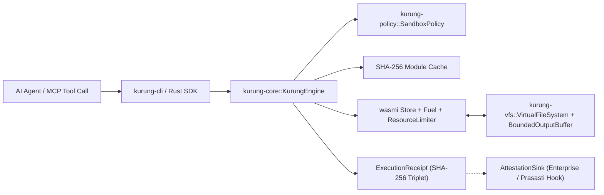

# Kurung (`kurung`) — Deterministic WASI/WASM Confinement Sandbox for AI Agents

[](#license)
[![Safety: #![forbid(unsafe_code)]](https://img.shields.io/badge/unsafe-forbidden-brightgreen.svg)](#security-architecture)
[](#verified-benchmarks)
[](#verified-benchmarks)

**`kurung`** (Indonesian: *cage / confinement / enclosure*) is a sub-millisecond, zero-`unsafe`, capability-based WebAssembly (`WASM`/`WAT`) execution sandbox engineered for **2027–2028 Autonomous AI Agent Swarms, Model Context Protocol (MCP) tool servers, and high-frequency quantitative sidecars**.

Part of the **Nusantara Rust Suite** alongside **`prasasti`** (Zero-Allocation Columnar Time-Series Engine).

---

## Why `kurung`?

As autonomous AI swarms transition from static chat assistants to dynamic code-synthesizing agents, executing untrusted LLM-generated tools inside Docker containers or microVMs introduces **150 ms – 1,500 ms** of cold-start latency and megabytes of memory overhead per call.

`kurung` eliminates container overhead while enforcing mathematically deterministic execution boundaries:

1. **Deterministic CPU Fuel Metering (`REQ-KRG-01`)**: Every WASM instruction deducts 1 unit of fuel. Infinite loops or algorithmic complexity attacks terminate deterministically with `KurungError::FuelExhausted` at the exact instruction boundary—independent of host CPU clock speed.
2. **Page-Aligned Linear Memory Ceiling (`REQ-KRG-02`)**: Custom `ResourceLimiter` blocks both static initial memory over-allocation and dynamic `memory.grow` bombs (`KurungError::MemoryLimitExceeded`) before host OS allocation occurs.
3. **Zero-Host-Leak In-Memory VFS (`REQ-KRG-03`)**: Default-deny capability policy (`SandboxPolicy::strict_default()`). Rejects `..`, backslash `\`, drive letters (`C:`), null bytes, and unprefixed paths. Guest tools interact strictly with an ephemeral, byte-quota-enforced in-memory `BTreeMap` Virtual File System.
4. **Bounded Stdout/Stderr Ring (`REQ-KRG-04`)**: Prevents stdout/log-flooding OOM attacks by truncating output deterministically at `max_output_bytes` and flagging `output_truncated: true` in the cryptographic receipt.
5. **SHA-256 Content-Addressable Module Cache (`REQ-KRG-05`)**: Compiles and validates a WASM module once per SHA-256 digest; subsequent agent invocations execute in **35 µs ($p_{50}$)**.
6. **Cryptographic Execution Receipt (`REQ-KRG-06`)**: Every run (whether `OK`, `FUEL_EXHAUSTED`, `MEMORY_LIMIT_EXCEEDED`, or `TRAP`) produces a tamper-evident `ExecutionReceipt` containing `module_sha256`, `input_sha256`, `output_sha256`, exact fuel consumed, peak linear memory, and microsecond duration.
7. **Open-Core Enterprise Telemetry Hook (`REQ-KRG-07`)**: Provides the `AttestationSink` trait so commercial enterprise control planes (`kurung-enterprise` or `prasasti`) can stream immutable audit logs in real time without modifying the open-source core.

---

## Workspace Architecture



| Crate | Path | Responsibility | `#![forbid(unsafe_code)]` |
| :--- | :--- | :--- | :---: |
| **`kurung-policy`** | `crates/kurung-policy` | Capability security policy (`SandboxPolicy`), limits validation, path traversal sanitizer | Enforced |
| **`kurung-vfs`** | `crates/kurung-vfs` | Ephemeral in-memory `VirtualFileSystem` with quota enforcement and `BoundedOutputBuffer` | Enforced |
| **`kurung-core`** | `crates/kurung-core` | `KurungEngine`, SHA-256 module cache, fuel/memory limiters, host ABI bridge, `ExecutionReceipt`, `AttestationSink` | Enforced |
| **`kurung-cli`** | `crates/kurung-cli` | CLI binary (`kurung run`, `kurung bench`, `kurung audit-self`) | Enforced |

---

## Verified Benchmarks

Measured on `x86_64-pc-windows-msvc` (`cargo build --release`, 1,000 iterations):

```text
================================================================
KURUNG DETERMINISTIC SANDBOX BENCHMARK (1000 ITERATIONS)
================================================================
Cold Start Latency (Compile + Exec) : 787 us (0.787 ms)
Warm Cached Latency p50             : 35 us (0.035 ms)
Warm Cached Latency p99             : 56 us (0.056 ms)
Fuel Consumed per Run               : 406 instructions
Module SHA-256                      : 96a6f476d8f2bdec372331c868c413dff492e9d2ee658bedfdbdf7d68bdbec3c
SLA Verification (Cold <= 2000 us)  : PASSED
================================================================
```

---

## Quick Start

### 1. Run Built-In 4-Stage Red-Team Adversarial Self-Audit
```bash
cargo run --release -p kurung-cli -- audit-self
```
Output:
```text
Running Kurung 4-Stage Red-Team Adversarial Self-Audit...
  [PASS] Stage 1: Infinite Loop Deterministic Fuel Cutoff
  [PASS] Stage 2: Linear Memory Bomb Rejection
  [PASS] Stage 3: Stdout Flood Bounded Truncation
  [PASS] Stage 4: VFS Default-Deny & Path Traversal Guard
ALL 4 ADVERSARIAL SECURITY GATES PASSED.
```

### 2. Execute an AI Agent Tool (`.wat` or `.wasm`) with Cryptographic Receipt
```bash
cargo run --release -p kurung-cli -- run examples/agent_math.wat --input "NUSANTARA_2027" --json
```
Output:
```json
{
  "return_value": 399,
  "stdout": [75, 85, 82, 85, 78, 71, 95, 65, 71, 69, 78, 84, 95, 84, 79, 79, 76, 95, 79, 75],
  "receipt": {
    "module_sha256": "bf412c7a742f99d973782f895281825d7f8324ba8334a5b34dceadab74e6924e",
    "input_sha256": "014412f92abd48abbe79f1d7e40ef3780770a818b2a5a4349385184f41f0f279",
    "output_sha256": "e42b58544c970d5b1f78cc28c4eb82210fea8272c02ba0d3d311ffa5d2514eb1",
    "fuel_limit": 500000,
    "fuel_consumed": 57,
    "peak_memory_bytes": 65536,
    "output_truncated": false,
    "cache_hit": false,
    "duration_us": 308,
    "status": "OK"
  }
}
```

### 3. Embed `kurung-core` in Rust
```rust
use kurung_core::KurungEngine;
use kurung_policy::SandboxPolicy;

fn main() -> Result<(), Box<dyn std::error::Error>> {
    let mut policy = SandboxPolicy::strict_default();
    policy.max_fuel = 100_000;
    policy.max_memory_bytes = 4 * 1024 * 1024; // 4 MiB ceiling

    let engine = KurungEngine::new(policy)?;
    let wat = r#"
        (module
            (func (export "run") (result i64)
                i64.const 42
            )
        )
    "#;

    let outcome = engine.execute_wat(wat, "run", b"input_payload")?;
    assert_eq!(outcome.return_value, 42);
    println!("Receipt SHA-256: {}", outcome.receipt.module_sha256);
    Ok(())
}
```

---

## Guest Host ABI (`"kurung"` Import Namespace)

Guest `.wasm` / `.wat` modules can optionally import the following deterministic host functions:

| Import Signature | Description | Return Code |
| :--- | :--- | :--- |
| `(import "kurung" "input_len" (func (result i32)))` | Returns byte length of host input payload | `>= 0` |
| `(import "kurung" "read_input" (func (param i32 i32) (result i32)))` | Copies up to `param1` bytes of input into guest linear memory at `param0` | Bytes copied (`>= 0`), or `-1` on out-of-bounds |
| `(import "kurung" "write_output" (func (param i32 i32) (result i32)))` | Writes `param1` bytes from guest memory at `param0` into bounded stdout buffer | Bytes accepted (`>= 0`), or `-1` on out-of-bounds |
| `(import "kurung" "vfs_read" (func (param i32 i32 i32 i32) (result i32)))` | Reads virtual path `(ptr, len)` into buffer `(dest_ptr, cap)` | Bytes read (`>= 0`), `-1` memory fault, `-2` policy/VFS denial |
| `(import "kurung" "vfs_write" (func (param i32 i32 i32 i32) (result i32)))` | Writes buffer `(src_ptr, src_len)` to virtual path `(path_ptr, path_len)` | Bytes written (`>= 0`), `-1` memory fault, `-2` policy/quota denial |

---

## License

Dual-licensed under **MIT** OR **Apache-2.0** (Open-Core Community Edition).
