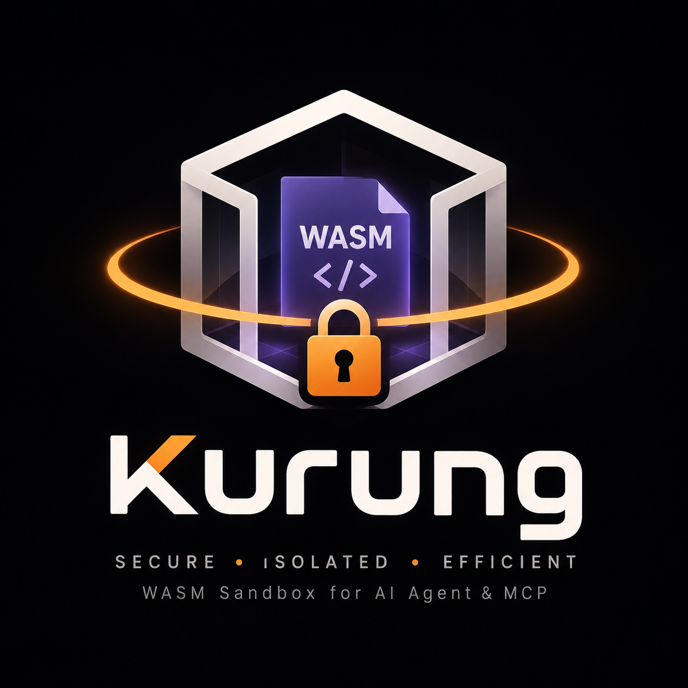
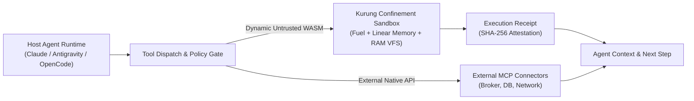
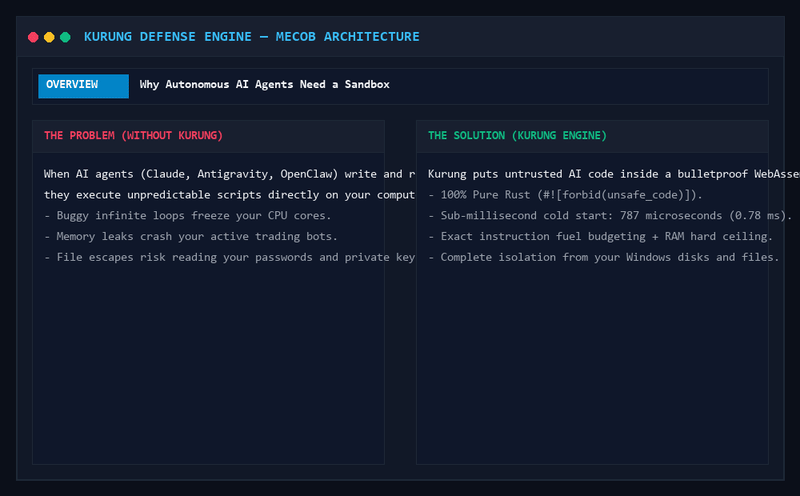

<p align="center">
  
</p>

# kurung

[](https://github.com/koodoxz/kurung/actions/workflows/ci.yml)
[](https://www.rust-lang.org)
[](https://www.rust-lang.org)
[](https://github.com/koodoxz/kurung)
[](https://modelcontextprotocol.io)
[](LICENSE)
[%5D-brightgreen.svg)](#security-guarantees--threat-boundaries)
[](#verified-benchmarks)
[](#verified-benchmarks)
[](https://github.com/koodoxz)

**`kurung`** (an Indonesian term meaning *cage*, *conclosure*, or *strict confinement*) is a sub-millisecond, pure-Rust WebAssembly execution sandbox engineered for **autonomous AI agents, LLM tool synthesis, and Model Context Protocol (MCP) servers**.

Part of the **MECOB ecosystem**.

---

## What is `kurung`?

When autonomous AI agents generate and execute code dynamically (such as calculating math, transforming data, or querying APIs), executing that code directly on the host operating system creates critical vulnerabilities:
- **Infinite loops** that freeze CPU cores.
- **Memory exhaustion attacks** (allocating gigabytes of RAM until the host crashes).
- **Filesystem escape** (`..`, `C:\`, `/etc/passwd`) that compromises host files.

Traditional isolation solutions introduce severe trade-offs:
- **Docker Containers**: Safe, but cold-start latency is 300 ms to 1,500 ms, with dozens of megabytes of memory overhead per instance.
- **MicroVMs (Firecracker / gVisor)**: Safe, but requires Linux KVM virtualization and is difficult to embed inside desktop or trading host processes.

**`kurung` eliminates this trade-off.** It runs compiled WebAssembly (`.wasm` or `.wat`) inside a capability-isolated in-process sandbox with:
- **787 microseconds (0.78 ms)** cold-start compilation and execution.
- **35 microseconds** warm cached execution.
- **100% pure Rust** with `#![forbid(unsafe_code)]` using the battle-tested `wasmi` deterministic interpreter.

---

## AI Agent Architecture & Execution Boundary

`kurung` operates strictly at the **Execution Isolation Layer**, separating runtime confinement from semantic agent policies:



---

## Architectural Simulation (Before vs After)



> 📹 *High-definition video available at [`docs/assets/kurung_simulation.mp4`](docs/assets/kurung_simulation.mp4).*

---

## Security Guarantees & Threat Boundaries

| Threat Vector | Kurung Defense Mechanism | Status | Scope Boundary |
|:---|:---|:---:|:---|
| **CPU Lockup (Infinite Loop)** | Instruction-level fuel metering via `wasmi` | **Enforced** | Deterministic cutoff at instruction boundary |
| **Guest RAM Bomb (`memory.grow`)** | Page-aligned linear memory ceiling (e.g. 16 MiB) | **Enforced** | Rejection without crashing host OS |
| **Filesystem Escape (`..`, `C:\`, `/etc`)** | Ephemeral in-memory RAM VFS | **Enforced** | Host disk is isolated; zero disk leaks |
| **Path Traversal & Null Byte Injection** | Strict path sanitization (`\0`, `\`, `:`) | **Enforced** | Hard reject on invalid virtual path syntax |
| **Log Flooding / Memory Hijack** | Bounded stdout buffer threshold | **Enforced** | Output truncated at configured byte limit |
| **Execution Tampering** | SHA-256 digest triplet receipt | **Enforced** | Verifiable attestation for audit ledgers |
| **Agent Semantic Abuse (e.g. fund transfer)** | Out of scope for runtime sandbox | **External** | Managed by outer agent policy & human approval |
| **Module Cache Flooding DoS** | Content-addressable SHA-256 module cache | **v0.2 Roadmap** | Adding bounded LRU cache (128 modules / 64 MiB) |
| **Blocking Host Call Hang** | Instruction-level fuel budgeting | **v0.2 Roadmap** | Adding wall-clock hard deadline timer |

---

## Verified Benchmarks

Measured on `x86_64-pc-windows-msvc`, Release Profile (`cargo build --release`), 1,000 iterations:

```
================================================================
KURUNG DETERMINISTIC SANDBOX BENCHMARK (1000 ITERATIONS)
================================================================
Cold Start Latency (Compile + Exec) : 787 us (0.787 ms)
Warm Cached Latency p50             : 35 us (0.035 ms)
Warm Cached Latency p99             : 56 us (0.056 ms)
Fuel Consumed per Run               : 406 instructions
Module SHA-256                      : 96a6f476d8f2bdec372331c868c413dff492e9d2ee658bedfdbdf7d68bdbec3c
SLA Verification (Cold <= 2,000 us) : PASSED
================================================================
```

---

## How to Use `kurung` with Other Applications

### 1. Embedded inside a Rust Application

Add `kurung-core` and `kurung-policy` to your `Cargo.toml`:

```toml
[dependencies]
kurung-core = { path = "path/to/crates/kurung-core" }
kurung-policy = { path = "path/to/crates/kurung-policy" }
```

Execute an AI-generated algorithm safely:

```rust
use kurung_core::KurungEngine;
use kurung_policy::SandboxPolicy;

fn main() -> Result<(), Box<dyn std::error::Error>> {
    // 1. Configure deterministic bounds
    let mut policy = SandboxPolicy::strict_default();
    policy.max_fuel = 100_000;                 // Max 100,000 instructions
    policy.max_memory_bytes = 4 * 1024 * 1024; // 4 MiB RAM ceiling

    let engine = KurungEngine::new(policy)?;

    // 2. Untrusted code supplied by an AI agent or external user
    let wat_code = r#"
        (module
            (func (export "run") (result i64)
                i64.const 42
            )
        )
    "#;

    // 3. Execute with sub-millisecond cold start
    let outcome = engine.execute_wat(wat_code, "run", b"payload")?;
    println!("Return Value : {}", outcome.return_value);
    println!("Fuel Used    : {}", outcome.receipt.fuel_consumed);
    println!("Module Hash  : {}", outcome.receipt.module_sha256);

    Ok(())
}
```

---

### 2. Integration with Model Context Protocol (MCP) & Agent Swarms

`kurung` includes a native, zero-dependency MCP stdio server. It can be registered directly in Claude Desktop, Antigravity IDE, Cursor, or OpenClaw:

```json
{
  "mcpServers": {
    "kurung": {
      "command": "kurung",
      "args": ["mcp"]
    }
  }
}
```

When an LLM synthesizes a mathematical model or strategy filter, it invokes `kurung_run_wasm` to test the code deterministically. If the LLM generates a broken infinite loop (`while (true) {}`), `kurung` safely aborts execution and returns:

```json
{
  "status": "FUEL_EXHAUSTED",
  "fuel_consumed": 500000,
  "fuel_limit": 500000
}
```

The AI agent receives this structured receipt and can self-correct its code without crashing the host IDE or server.

---

### 3. Integration with Python & Quantitative Trading Bots

Call `kurung` from Python sidecars via subprocess or CLI:

```python
import subprocess
import json

def run_agent_tool(wasm_path: str, payload: str):
    cmd = [
        "kurung", "run", wasm_path,
        "--entry", "run",
        "--input", payload,
        "--json"
    ]
    res = subprocess.run(cmd, capture_output=True, text=True)
    return json.loads(res.stdout)

# Safe execution of dynamic user logic inside quantitative pipelines
result = run_agent_tool("tools/arbitrage_filter.wasm", "TICK_DATA")
print(f"Receipt: {result['receipt']['module_sha256']}")
```

---

## Workspace Crates

- `crates/kurung-policy`: Capability security policies, parameter limits, and path sanitization.
- `crates/kurung-vfs`: Ephemeral in-memory `VirtualFileSystem` and bounded output buffers.
- `crates/kurung-core`: `KurungEngine`, host ABI bridge, module caching, and execution receipts.
- `crates/kurung-cli`: Command-line interface for running modules, self-audits, and benchmarks.

---

## Verification & Self-Audit

Run the full test suite across all crates:

```bash
cargo test --workspace --all-targets
```

Run static analysis with zero warnings permitted:

```bash
cargo clippy --all-targets -- -D warnings
```

Run the built-in 4-stage adversarial self-audit:

```bash
cargo run --release -p kurung-cli -- audit-self
```

Run the performance benchmark:

```bash
cargo run --release -p kurung-cli -- bench --iterations 1000
```

---

## License

Dual-licensed under MIT OR Apache-2.0. Part of the **MECOB ecosystem**.
