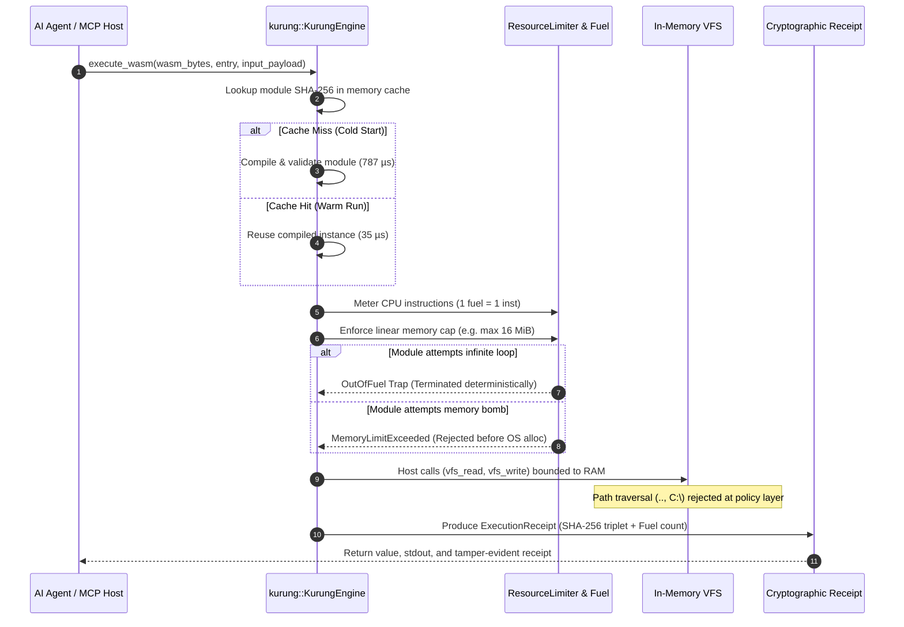

# kurung

[](https://github.com/koodoxz/kurung/actions/workflows/ci.yml)
[](https://www.rust-lang.org)
[](LICENSE)
[%5D-brightgreen.svg)](#security-guarantees)
[](#verified-benchmarks)
[](#verified-benchmarks)
[](https://github.com/koodoxz)

**`kurung`** (an Indonesian term meaning *cage*, *conclosure*, or *strict confinement*) is a sub-millisecond, pure-Rust WebAssembly execution sandbox engineered for **autonomous AI agents, LLM tool synthesis, and Model Context Protocol (MCP) servers**.

Part of the **MECOB ecosystem**.

---

## What is `kurung`?

When autonomous AI agents generate and execute code dynamically (such as calculating math, transforming data, or querying APIs), executing that code directly on the host operating system creates critical vulnerabilities:
- **Infinite loops** that freeze CPU cores.
- **Memory exhaustion attacks** (allocating gigabytes of RAM until the host crashes).
- **Filesystem escape** (`..`, `C:\`, `/etc/passwd`) that compromises host files.

Traditional isolation solutions introduce severe trade-offs:
- **Docker Containers**: Safe, but cold-start latency is 300 ms to 1,500 ms, with dozens of megabytes of memory overhead per instance.
- **MicroVMs (Firecracker / gVisor)**: Safe, but requires Linux KVM virtualization and is difficult to embed inside desktop or trading host processes.

**`kurung` eliminates this trade-off.** It runs compiled WebAssembly (`.wasm` or `.wat`) inside a capability-isolated in-process sandbox with:
- **787 microseconds (0.78 ms)** cold-start compilation and execution.
- **35 microseconds** warm cached execution.
- **100% pure Rust** with `#![forbid(unsafe_code)]`.

---

## Architectural Simulation & Execution Flow



---

## Security Guarantees

1. **Deterministic CPU Fuel Metering**: Every WebAssembly instruction deducts exactly 1 unit of fuel from the store. When the fuel budget is exhausted, execution aborts immediately at the exact instruction boundary.
2. **Page-Aligned Memory Ceiling**: Enforces an unbypassable linear memory ceiling. Calls to `memory.grow` beyond the quota fail safely without crashing the host process.
3. **Zero-Host-Leak In-Memory VFS**: File operations use an ephemeral, RAM-only `VirtualFileSystem` under a default-deny policy. Path traversal sequences (`..`, `\`, null bytes, drive prefixes) are rejected before execution.
4. **Bounded Output Buffering**: Guest standard output is limited to a configurable byte threshold to eliminate log-flooding memory attacks.
5. **Content-Addressable Module Cache**: Thread-safe in-memory caching keyed by module SHA-256 digest, cutting invocation latency to 35 microseconds ($p_{50}$).
6. **Cryptographic Execution Receipts**: Every execution outputs a structured receipt containing SHA-256 hashes of the module, input payload, and output buffer, alongside exact fuel consumption and duration.
7. **Zero Unsafe Code**: Strictly enforces `#![forbid(unsafe_code)]` across all workspace crates.

---

## Verified Benchmarks

Measured on `x86_64-pc-windows-msvc`, Release Profile (`cargo build --release`), 1,000 iterations:

```
================================================================
KURUNG DETERMINISTIC SANDBOX BENCHMARK (1000 ITERATIONS)
================================================================
Cold Start Latency (Compile + Exec) : 787 us (0.787 ms)
Warm Cached Latency p50             : 35 us (0.035 ms)
Warm Cached Latency p99             : 56 us (0.056 ms)
Fuel Consumed per Run               : 406 instructions
Module SHA-256                      : 96a6f476d8f2bdec372331c868c413dff492e9d2ee658bedfdbdf7d68bdbec3c
SLA Verification (Cold <= 2,000 us) : PASSED
================================================================
```

---

## How to Use `kurung` with Other Applications

### 1. Embedded inside a Rust Application

Add `kurung-core` and `kurung-policy` to your `Cargo.toml`:

```toml
[dependencies]
kurung-core = { path = "path/to/crates/kurung-core" }
kurung-policy = { path = "path/to/crates/kurung-policy" }
```

Execute an AI-generated algorithm safely:

```rust
use kurung_core::KurungEngine;
use kurung_policy::SandboxPolicy;

fn main() -> Result<(), Box<dyn std::error::Error>> {
    // 1. Configure deterministic bounds
    let mut policy = SandboxPolicy::strict_default();
    policy.max_fuel = 100_000;              // Max 100,000 instructions
    policy.max_memory_bytes = 4 * 1024 * 1024; // 4 MiB RAM ceiling

    let engine = KurungEngine::new(policy)?;

    // 2. Untrusted code supplied by an AI agent or external user
    let wat_code = r#"
        (module
            (func (export "run") (result i64)
                i64.const 42
            )
        )
    "#;

    // 3. Execute with sub-millisecond cold start
    let outcome = engine.execute_wat(wat_code, "run", b"payload")?;
    println!("Return Value : {}", outcome.return_value);
    println!("Fuel Used    : {}", outcome.receipt.fuel_consumed);
    println!("Module Hash  : {}", outcome.receipt.module_sha256);

    Ok(())
}
```

---

### 2. Integration with Model Context Protocol (MCP) & Agent Swarms

`kurung` can be registered as a local MCP tool server for LLMs (Claude Desktop, Antigravity IDE, Cursor, OpenClaw):

```json
{
  "mcpServers": {
    "kurung": {
      "command": "kurung",
      "args": ["run", "--json"]
    }
  }
}
```

When an LLM synthesizes a mathematical model or strategy filter, it invokes `kurung` to test the code deterministically. If the LLM generates a broken infinite loop (`while (true) {}`), `kurung` safely aborts execution and returns:

```json
{
  "status": "FUEL_EXHAUSTED",
  "fuel_consumed": 500000,
  "fuel_limit": 500000
}
```

The AI agent receives this structured receipt and can self-correct its code without crashing the host IDE or server.

---

### 3. Integration with Python & Quantitative Trading Bots

Call `kurung` from Python sidecars via subprocess or CLI:

```python
import subprocess
import json

def run_agent_tool(wasm_path: str, payload: str):
    cmd = [
        "kurung", "run", wasm_path,
        "--entry", "run",
        "--input", payload,
        "--json"
    ]
    res = subprocess.run(cmd, capture_output=True, text=True)
    return json.loads(res.stdout)

# Safe execution of dynamic user logic inside quantitative pipelines
result = run_agent_tool("tools/arbitrage_filter.wasm", "TICK_DATA")
print(f"Receipt: {result['receipt']['module_sha256']}")
```

---

## Workspace Crates

- `crates/kurung-policy`: Capability security policies, parameter limits, and path sanitization.
- `crates/kurung-vfs`: Ephemeral in-memory `VirtualFileSystem` and bounded output buffers.
- `crates/kurung-core`: `KurungEngine`, host ABI bridge, module caching, and execution receipts.
- `crates/kurung-cli`: Command-line interface for running modules, self-audits, and benchmarks.

---

## Verification & Self-Audit

Run the full test suite across all crates:

```bash
cargo test --workspace --all-targets
```

Run static analysis with zero warnings permitted:

```bash
cargo clippy --all-targets -- -D warnings
```

Run the built-in 4-stage adversarial self-audit:

```bash
cargo run --release -p kurung-cli -- audit-self
```

Run the performance benchmark:

```bash
cargo run --release -p kurung-cli -- bench --iterations 1000
```

---

## License

Dual-licensed under MIT OR Apache-2.0. Part of the **MECOB ecosystem**.
